# Puppet Story Studio — Software Architecture

## 1. System overview

Puppet Story Studio is a static, browser-based application that transforms a written story into a continuous puppet-show performance. The browser performs story parsing, cast and voice assignment, scene and action planning, puppet composition, animation, subtitles, and speech. Cloudflare Workers AI is an optional enrichment service for complex or uncertain physical actions; the local rule-based mapper remains the source of truth and fallback.

```mermaid
flowchart LR
  U[Storyteller] --> UI[Story input page\nindex.html + input.js]
  UI -->|story in sessionStorage| SHOW[Show page\npuppet-show.html + app.js]
  SHOW --> PARSE[Local story parser\nacts, cast, dialogue, scenes]
  PARSE --> ENRICH{Complex action\nand eligible input?}
  ENRICH -->|No| PLAN[Validated show plan]
  ENRICH -->|Yes| WORKER[Cloudflare Worker\nworker/src/index.js]
  WORKER --> WAI[Workers AI\nGPT-OSS 20B]
  WAI --> WORKER
  WORKER -->|bounded suggestions| VALIDATE[Browser validation]
  VALIDATE --> PLAN
  VALIDATE -->|failure / invalid / low confidence| PLAN
  PLAN --> ASSETS[Asset loader\npuppets + backgrounds + props]
  ASSETS --> RENDER[Canvas stage renderer]
  PLAN --> PLAYBACK[Timeline + movement scheduler]
  PLAYBACK --> RENDER
  PLAYBACK --> TTS[Browser Web Speech API]
  TTS --> AUDIO[Device speech output]
  RENDER --> OUTPUT[Live puppet show\ncharacters + actions + captions]
  GH[GitHub repository] --> PAGES[GitHub Pages]
  GH -->|optional secret| WORKER
  PAGES --> UI
```



## 2. Runtime components

| Component | Location | Responsibility |
|---|---|---|
| Story input UI | `index.html`, `input.js` | Accept pasted or `.txt` stories, estimate conversion and show duration, retain story for the show page. |
| Show application | `puppet-show.html`, `app.js` | Parse the story, map speakers/actions/scenes, optionally enrich complex actions, validate the plan, preload assets, and control playback. |
| Responsive presentation | `style.css` | Style both pages and keep the show stage, controls, and captions usable across desktop, tablet, and mobile viewports. |
| Asset library | `assets/puppets/`, `assets/backgrounds/` | Supply puppet art, character templates/rig parts, props, rides, and scene artwork. |
| AI endpoint configuration | `ai-config.js` | Hold the public Cloudflare Worker endpoint used by the browser. No provider secret belongs in this file. |
| Enrichment service | `worker/src/index.js` | Enforce request limits and CORS, call Workers AI, parse its response, and constrain suggestions to supported actors, roles, moments, settings, and props. |
| Local launch helpers | `server.ps1`, `server.py`, `start-windows.bat`, `start-macos-linux.sh` | Open or serve the static application for local use. |
| Deployment workflow | `.github/workflows/pages.yml` | Assemble and publish the static site to GitHub Pages; deploy the Worker when the Cloudflare token secret is configured. |

## 3. Story-to-show data flow

1. The storyteller pastes a story or selects a text file on the input page.
2. The input page calculates a rough conversion estimate and stores the story in browser `sessionStorage` before opening the show page.
3. The show application normalizes and segments the text into acts. It identifies named characters and roles, assigns dialogue to characters where the text supports attribution, and creates narrator-led action/scene text for non-dialogue material.
4. The local mapper assigns each act its speaker, action/movement kind, target when known, setting, time cue, participants, positions, and duration. It caps supported cast and story length and may shorten long stories toward the configured show-duration ceiling.
5. If an eligible action is complex or uncertain, the browser may send a bounded enrichment request to the Worker. The Worker returns suggestions only; the browser checks them against the existing cast, role, movement vocabulary, and equipped assets. It cannot introduce characters, change dialogue attribution, or invent unsupported animal props.
6. A failed, rejected, low-confidence, timed-out, or unavailable enrichment result leaves the local plan in place.
7. The application preloads puppet and background images, creates the cast and act timeline, and starts the continuous performance.
8. The playback scheduler coordinates speech, scene state, action offsets, movement duration, captions, and canvas frames. The last frame remains visible at the end.

## 4. Principal runtime data

The application keeps the show plan in browser memory. Conceptually, it contains:

```text
Show
  story metadata and duration
  characters[]
    name, role, visual/voice identity, available assets, stage data
  acts[]
    speaker, text, dialogue/action classification
    setting, time of day, participants and targets
    movement kind, duration, action offset, prop/ride slots
    stage positions
```

The exact object fields are implementation details in `app.js`; this conceptual schema describes the information that must survive parsing, enrichment, and rendering. Enrichment is additive and constrained: it may refine supported action metadata, but must not replace the browser’s cast or dialogue decisions.

## 5. Performance and rendering

- The stage is rendered in the browser using Canvas. Backgrounds, character templates, articulated rigs, props, and ride assets are composed into a frame based on the active act and elapsed playback time.
- Characters are positioned per act and setting. The renderer uses role-aware actions so animal, bird, object, and human actors receive compatible movement kinds and props.
- Human templates and the articulated king rig use dedicated movement paths. Animal sprites can use body-and-limb artwork for walking/running/riding cycles where supplied.
- Mounted actions compose rider and mount together; boat and horse rides use their corresponding assets.
- Scene backgrounds are preloaded and changed with scene transitions. Time-of-day cues affect scene lighting independently of the location.
- The timeline marks the active act and speaker. The stage caption stays attached to the lower edge of the stage.
- Speech is generated at runtime by the browser’s Web Speech API. Available voices and audio quality vary by browser, operating system, and installed voices. No audio or video file is rendered or downloaded.

## 6. AI enrichment boundary

The browser calls the Worker only for complex/uncertain physical-action refinement and only within configured input limits. The Worker uses the `@cf/openai/gpt-oss-20b` Workers AI model. It validates request shape and normalizes model output against explicit allowlists for settings, times, movement kinds, roles, and props. Actor and target names must match the known cast. Human-only props/moments remain restricted to humans. Model output is treated as untrusted and cannot bypass the browser’s validation. Local parsing and performance remain usable without the Worker.

## 7. Deployment and configuration

- GitHub Pages publishes the static browser application from the repository’s `main` branch through `.github/workflows/pages.yml`.
- The Worker deploy step is conditional on the GitHub Actions secret `CLOUDFLARE_API_TOKEN`; Pages deployment does not depend on it.
- `ai-config.js` contains the public Worker URL. Cloudflare credentials must remain in GitHub Actions secrets or a local secret store, never in browser files or commits.
- The app can be opened as a hosted static site or run with the included local launch helpers.

## 8. Resilience and failure handling

| Failure | Expected behavior |
|---|---|
| Worker URL missing or Worker unavailable | Continue with local action mapping. |
| AI timeout, quota/rate limit, invalid JSON, unsupported value, or low confidence | Discard unsafe suggestions and keep the local plan. |
| Individual image unavailable | Other characters and scenes should continue to render; asset failures should be diagnosable without stopping playback. |
| Browser speech unavailable or no suitable voice installed | Visual performance remains available; speech capability depends on the browser/device. |
| Long story | Apply configured duration and act limits while retaining high-value story moments. |

## 9. Security and trust boundaries

- The browser is a public client; all files delivered by Pages are inspectable. Only public configuration belongs there.
- The Worker owns the model call and applies CORS, method/request checks, input limits, and output normalization.
- Model-generated strings and enum values are untrusted. The browser must validate them against the story’s known characters and supported visual capabilities before playback.
- External model availability and quotas must never be required for baseline story conversion or show playback.

## 10. Repository map

```text
index.html                    Story entry page
input.js                      Input, file loading, estimate, and handoff
puppet-show.html              Show page structure
app.js                        Story mapping, validation, rendering, and playback
style.css                     Responsive page and stage styles
ai-config.js                  Public Worker URL configuration
worker/src/index.js           Cloudflare Workers AI proxy and response validation
assets/puppets/               Character, rig, and prop artwork
assets/backgrounds/           Illustrated locations and stage scenes
.github/workflows/pages.yml   GitHub Pages and optional Worker deployment
README.md                     Run instructions and current capability notes
```

## 11. Architecture constraints

- Preserve story meaning and named cast through every stage of processing.
- Keep dialogue attribution separate from narrated action and scene description.
- Do not allow an AI suggestion to create duplicate characters or unsupported assets.
- Keep role compatibility, prop ownership, and mount compatibility explicit in mapping and rendering.
- Keep playback timing tied to speech and movement duration; avoid advancing the scene before the spoken/action beat finishes.
- Keep the entire stage and its bottom-anchored caption visible at supported viewport sizes.
- Keep the deterministic local path complete enough to run when the optional enrichment service is not available.
